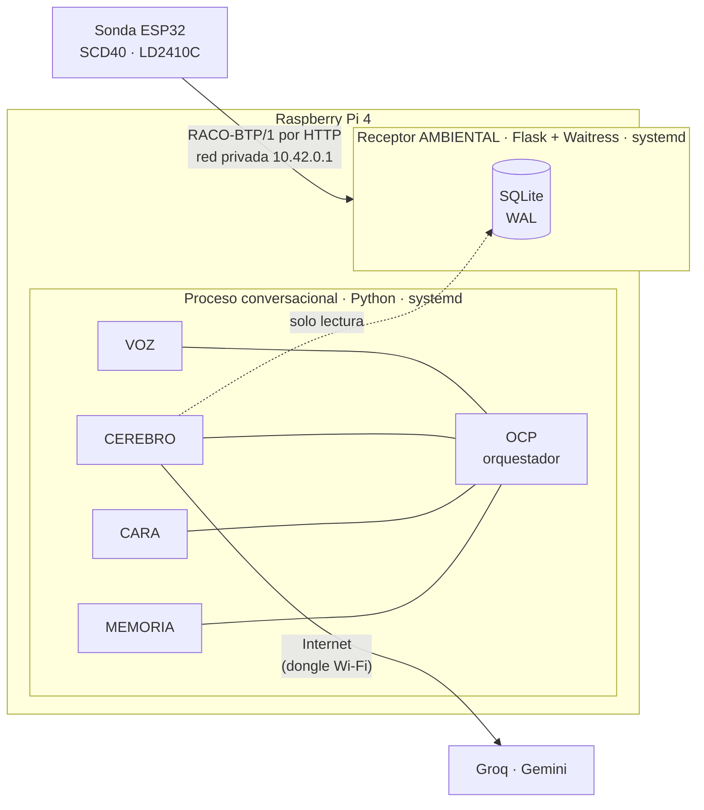
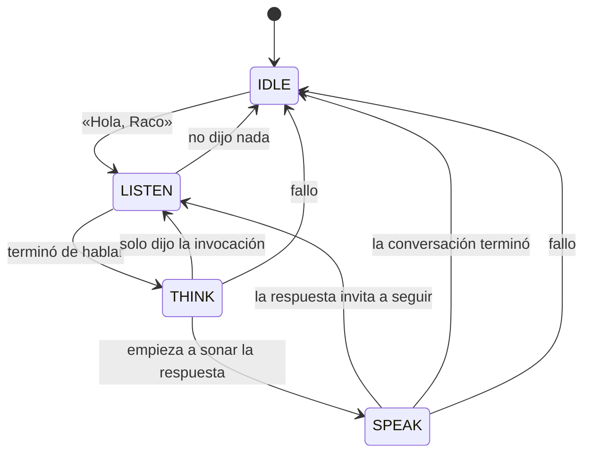

# RACO

RACO es un asistente físico de escritorio: escucha la invocación «Hola, Raco», conversa por voz,
muestra en una pequeña pantalla en qué fase de la conversación está y puede responder sobre el
ambiente de la habitación con mediciones reales de una sonda propia.

**Estado:** diseño completo, implementación en curso. Este repositorio publica una parte del diseño
(RACO-CORTEX): la arquitectura general y el protocolo entre la sonda y la Raspberry. El informe
completo es privado.

## Arquitectura

El sistema corre en tres lugares independientes y usa dos redes:

- **Proceso conversacional:** un único proceso Python. Todos los módulos publican sus eventos en una
  cola, y un único hilo del orquestador (OCP) los procesa de a uno. Es el único que cambia el estado.
- **Receptor ambiental:** un servicio aparte que recibe las tramas de la sonda y las guarda en SQLite.
  No depende del proceso conversacional ni de Internet.
- **Sonda:** una ESP32 autónoma que mide CO₂, temperatura, humedad y presencia cada 30 s, guarda cada
  trama en su flash y la entrega a la Raspberry.
- **Dos redes:** el Wi-Fi integrado de la Raspberry funciona como punto de acceso privado para la sonda,
  y un dongle Wi-Fi USB da salida a Internet. Así RACO funciona fuera de casa, sin cable.

## Subsistemas

| Subsistema | Qué hace |
|---|---|
| **OCP** | Orquestador: único dueño del estado conversacional y coordinador del resto |
| **VOZ** | Captura de audio, activación local «Hola, Raco», escucha, transcripción (Whisper) y voz sintética local (Piper) |
| **CEREBRO** | Respuestas con modelos de lenguaje (Groq, con Gemini de respaldo) y la herramienta de consulta ambiental |
| **CARA** | Expresión visual en una OLED SH1106 de 128 × 64, con brillo según la luz del ambiente |
| **MEMORIA** | Texto fijo con la identidad, las capacidades y los límites de RACO |
| **AMBIENTAL** | Sonda, recepción y almacenamiento durable de las mediciones |

## Estados de la conversación

OCP solo permite estas transiciones; cualquier otro evento se descarta sin cambiar el estado.

La escucha tolera pausas de hasta 2 s, corta a los 60 s, y después de cada respuesta deja 5 s para
una pregunta de seguimiento sin repetir la invocación.

## La familia de protocolos RACO-CORTEX

| Especificación | Nombre | Qué define |
|---|---|---|
| RACO-WKP/1 | Wake Keyword Pipeline | Activación local por voz; no se envía audio continuo a ningún servicio |
| RACO-OCP/1 | Orchestration Control Protocol | Eventos, órdenes y transiciones del orquestador |
| RACO-ASP/1 | Autonomous Sensing Pipeline | Adquisición autónoma de la sonda |
| **RACO-BTP/1** | **Binary Telemetry Protocol** | **Formato de trama y entrega con acuse entre sonda y receptor** |
| RACO-DIP/1 | Durable Ingestion Pipeline | Recepción y persistencia de la telemetría |
| RACO-FRP/1 | Failover Routing Policy | Respaldo Groq → Gemini → respuesta local |
| RACO-TEP/1 | Tool Execution Protocol | Pedidos y resultados de herramientas |
| RACO-TSP/1 | Text Streaming Protocol | Fragmentos de texto hacia la voz, con marca de fin |

La especificación completa de **RACO-BTP/1** está en [`docs/protocolo-raco-btp1.md`](docs/protocolo-raco-btp1.md).

## Principios de diseño

- **Aislamiento:** la conversación y el registro ambiental son procesos distintos; un fallo de uno no
  detiene al otro. Sin pantalla, RACO sigue conversando.
- **La sonda no depende de nadie:** mide, guarda y señaliza aunque la Raspberry, la red o los
  proveedores fallen.
- **No inventar datos:** un valor viejo no se presenta como actual y un estado desconocido no es ausencia.
- **Plazos finitos:** ninguna espera externa puede bloquear al orquestador.
