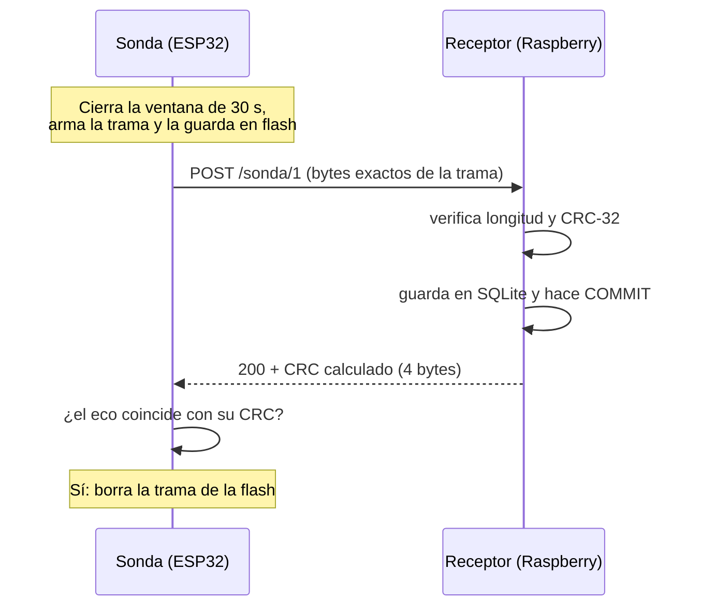
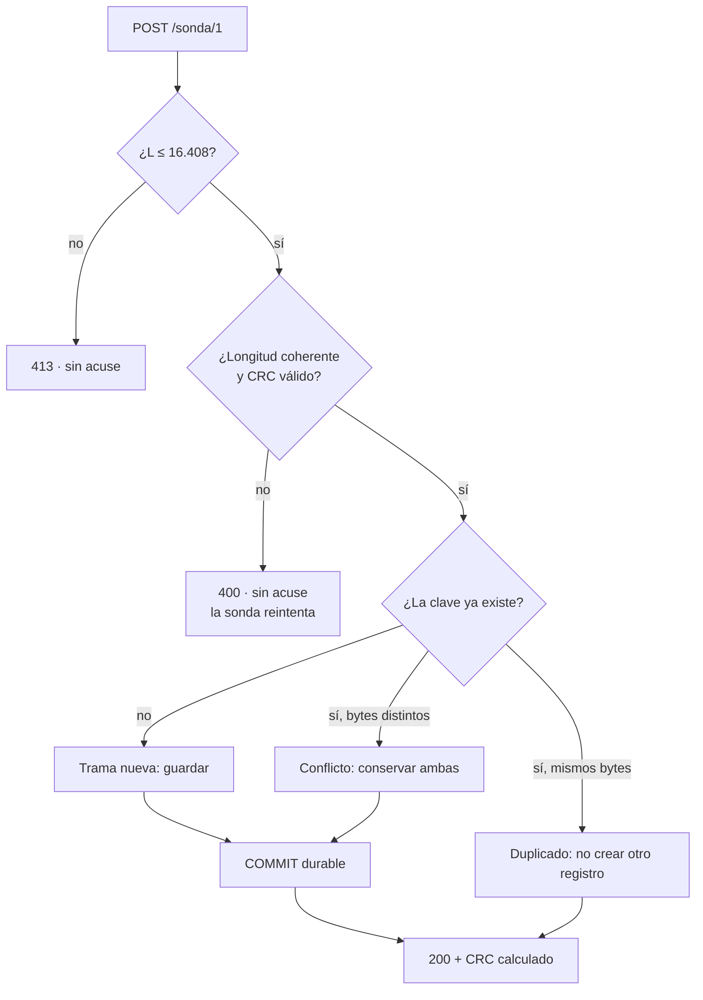
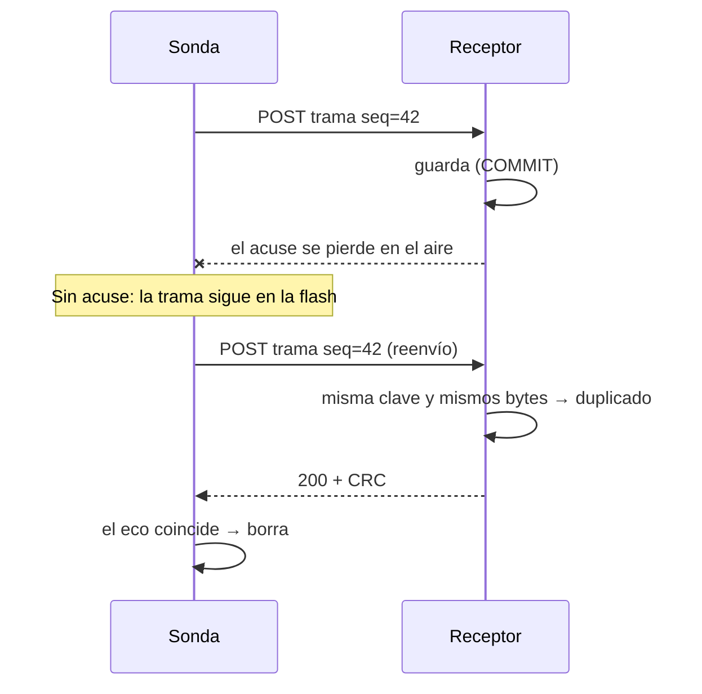

# RACO-BTP/1 — Binary Telemetry Protocol

Contrato entre la sonda ambiental (ESP32, firmware en C/C++) y el receptor de la Raspberry (Python).
Es el único punto donde dos programas escritos por separado deben coincidir byte a byte, por eso es
deliberadamente literal.

## Resumen

- Cada 30 s la sonda arma una **trama binaria** con sus mediciones, la guarda en su flash y la envía
  por **HTTP POST**.
- El receptor la guarda de forma durable y responde con el **CRC-32 que él calculó** como acuse.
- La sonda **solo borra la trama** si el acuse coincide con el CRC que tiene guardado.



## 1. Estructura de la trama

Longitud **L = 24 + 2N bytes**, con 0 ≤ N ≤ 8.192 (de 24 a 16.408 B), **little-endian** y **sin relleno**.

| Offset | Bytes | Tipo | Campo | Contenido |
|---|---|---|---|---|
| 0 | 1 | uint8 | `frame_version` | Versión del formato: 1 |
| 1 | 4 | uint32 | `boot_id` | Identificador del arranque |
| 5 | 2 | uint16 | `seq` | Número de ventana dentro del arranque |
| 7 | 4 | uint32 | `t_mono` | Inicio de la ventana, en segundos desde el arranque |
| 11 | 2 | uint16 | `co2_ppm` | CO₂ en ppm |
| 13 | 2 | int16 | `temp_x10` | Temperatura en °C × 10 |
| 15 | 1 | uint8 | `rh_x2` | Humedad relativa en % × 2 |
| 16 | 1 | uint8 | `radar_summary` | Estados inicial y final, y presencia en la ventana |
| 17 | 2 | uint16 | `event_count` | N, cantidad de transiciones del radar |
| 19 | 2N | uint16 × N | `radar_events` | Transiciones de la ventana |
| 19 + 2N | 1 | uint8 | `flags` | Banderas de la ventana |
| 20 + 2N | 4 | uint32 | `crc32` | CRC-32 de los bytes 0 a 19 + 2N |

```
 0      1           5      7           11       13        15     16       17          19            19+2N   20+2N
 ┌──────┬───────────┬──────┬───────────┬────────┬─────────┬──────┬────────┬───────────┬─────────────┬───────┬──────────┐
 │ ver  │  boot_id  │ seq  │  t_mono   │co2_ppm │temp_x10 │rh_x2 │ radar  │event_count│radar_events │ flags │  crc32   │
 │  1B  │    4B     │  2B  │    4B     │   2B   │   2B    │  1B  │summary │    2B     │    2N B     │  1B   │    4B    │
 └──────┴───────────┴──────┴───────────┴────────┴─────────┴──────┴────────┴───────────┴─────────────┴───────┴──────────┘
 └──────────────────────── encabezado fijo: 19 bytes ───────────────────────────────┘ └─ variable ─┘ └── cola: 5 B ──┘
```

Como los eventos están en el medio, `flags` y `crc32` se desplazan 2N bytes: un decodificador
primero lee `event_count` y recién ahí sabe dónde termina la trama.

**Por qué así:**
- **Un único formato, sin campos opcionales:** el decodificador es una traducción literal de la tabla.
- **Longitud derivable:** L se calcula desde N, lo que permite validar lo recibido y separar tramas
  concatenadas en un archivo.
- **Mediciones como enteros** (ppm, décimas de grado, medios puntos de humedad): sin coma flotante, no
  hay diferencias de representación entre la ESP32 y la Raspberry.

### Codificación de las mediciones

| Campo | Cálculo | Ejemplo | Nulo («no hay dato») |
|---|---|---|---|
| `co2_ppm` | Entero en ppm (válido 0 a 40.000) | 612 ppm → 612 | 65.535 |
| `temp_x10` | °C × 10, redondeado | 23,8 °C → 238; −5,3 °C → −53 | −32.768 |
| `rh_x2` | % × 2, redondeado (válido 0 a 200) | 46,5 % → 93 | 255 |

**Nulo no es cero:** 0 ppm es un valor válido aunque improbable. La sonda emite los tres nulos juntos
cuando en la ventana no terminó ninguna lectura válida del sensor.

### Radar

- `radar_summary`: bits 0–1 estado al inicio de la ventana, bits 2–3 estado al final, bit 4 hubo
  presencia; bits 5–7 reservados en 0.
- Cada `radar_events[i]`: bits 0–11 tick (10 ms desde el inicio de la ventana, de 0 a 2.999), bits
  12–13 nuevo estado (0 a 3); bits 14–15 reservados. Valor = tick + 4.096 × estado.

## 2. Integridad: CRC-32

CRC-32/ISO-HDLC (el mismo de `zlib.crc32`), calculado sobre todos los bytes anteriores y escrito en
little-endian:

1. `crc ← 0xFFFFFFFF`
2. Por cada byte `b`: `crc ← crc XOR b`; después, ocho veces: si el bit menos significativo es 1,
   `crc ← (crc >> 1) XOR 0xEDB88320`; si no, `crc ← crc >> 1`.
3. Resultado: `crc XOR 0xFFFFFFFF`

Valor de control: el CRC de `"123456789"` es `0xCBF43926`.

**Por qué no autentica:** cualquiera puede calcular un CRC, así que alguien dentro de la red podría
fabricar tramas «íntegras». El CRC protege contra la radio ruidosa, la flash dañada y los errores de
programación, no contra la mala fe. V1 supone una red privada de confianza (la red propia de RACO).

## 3. Identidad de la trama

La clave de una trama es **(`device_id`, `boot_id`, `seq`, `t_mono`)**.

`device_id` no viaja en la trama: el receptor lo deduce de la URL, que es exclusiva de cada sonda
(`/sonda/1`). Agregarlo solo sumaría bytes y una fuente de inconsistencia. La IP tampoco se usa,
porque puede cambiar.

## 4. Transporte HTTP

| Aspecto | Regla |
|---|---|
| Iniciativa | La sonda inicia toda comunicación |
| Protocolo | HTTP/1.1, sin TLS ni autenticación (red privada) |
| Destino | `http://10.42.0.1:8080/sonda/1` |
| Método y cuerpo | POST; el cuerpo son los L bytes exactos de una trama |
| Cabeceras | `Content-Type: application/octet-stream`; `Content-Length` = L |
| Concurrencia | Una trama por solicitud y una solicitud por vez |
| Límite | Hasta 16.408 B; más grande → 413, sin acuse |
| Acuse | 200 con un cuerpo de exactamente 4 bytes: el CRC calculado por el receptor |

## 5. El acuse durable

El acuse **autoriza a la sonda a borrar**. Por eso el receptor debe cumplir cinco reglas:

1. Responder 200 **solo después de guardar de forma durable** los bytes exactos, o de comprobar que ya
   tenía una copia idéntica. Si no hay copia durable, el borrado pierde la medición.
2. El eco es el CRC que **el propio receptor calcula** sobre lo que recibió. Si la trama llegó alterada,
   el eco no coincide y la sonda la reenvía.
3. Confirmar **toda trama íntegra que haya guardado**, sea dato nuevo, duplicado, conflicto o contenido
   que no puede interpretar. Sin acuse, la sonda reintenta para siempre.
4. **Idempotencia por clave:** misma clave y mismos bytes es un duplicado y se confirma otra vez; misma
   clave y bytes distintos es un conflicto, que se conserva sin reemplazar al registro anterior.
5. Aceptar tramas **fuera de orden** y reconstruir el orden con la clave.



### Qué pasa cuando algo falla



Como el receptor conserva los bytes originales para siempre, puede reconocer un duplicado con certeza
aunque llegue meses después.

## 6. Versionado

`frame_version = 1` es la versión del formato, distinta de la edición de este documento. Cualquier
cambio de offsets, tipos, rangos, significado de bits, CRC o regla de longitud exige otra versión.

Un receptor que no conoce una versión, **si el CRC es válido, conserva los bytes y confirma**: el CRC
ocupa siempre los últimos 4 bytes, así que la integridad se puede verificar sin entender el contenido.
Si negara el acuse, la sonda reintentaría para siempre.

## 7. Vectores de prueba

Ejemplo de conformidad, L = 30:

```
01 07 00 00 00 2A 00 CE 04 00 00 64 02 EE 00 5C 10 03 00 EB 10 EC 24 C0 08 00 A5 27 34 10
```

| Bytes | Campo | Valor | Significado |
|---|---|---|---|
| `01` | frame_version | 1 | Versión 1 |
| `07 00 00 00` | boot_id | 7 | Arranque número 7 |
| `2A 00` | seq | 42 | Ventana 42 |
| `CE 04 00 00` | t_mono | 1.230 | Empezó a los 1.230 s del arranque |
| `64 02` | co2_ppm | 612 | 612 ppm |
| `EE 00` | temp_x10 | 238 | 23,8 °C |
| `5C` | rh_x2 | 92 | 46 % |
| `10` | radar_summary | 0x10 | Empieza y termina en ausencia, hubo presencia |
| `03 00` | event_count | 3 | Tres transiciones |
| `EB 10` | evento 1 | 0x10EB | Tick 235 (2,35 s): movimiento |
| `EC 24` | evento 2 | 0x24EC | Tick 1.260 (12,60 s): quietud |
| `C0 08` | evento 3 | 0x08C0 | Tick 2.240 (22,40 s): ausencia |
| `00` | flags | 0 | Sin banderas |
| `A5 27 34 10` | crc32 | 0x103427A5 | CRC de los 26 bytes anteriores |

Vectores adicionales (todos con `boot_id = 7`):

| ID | Caso | L | Bytes (hex) | Resultado esperado |
|---|---|---|---|---|
| V2 | N = 0, valores normales | 24 | `01 07 00 00 00 2B 00 EC 04 00 00 67 02 EF 00 5C 00 00 00 00 09 D1 B4 33` | Guardar, interpretar y acusar |
| V3 | Nulos del sensor | 24 | `01 07 00 00 00 2C 00 0A 05 00 00 FF FF 00 80 FF 00 00 00 01 A3 44 97 83` | Mediciones en NULL; acusar |
| V4 | Error de radar | 24 | `01 07 00 00 00 2D 00 28 05 00 00 67 02 EF 00 5C 00 00 00 02 92 F6 BB B9` | Radar incierto (no ausencia); acusar |
| V5 | Evento en tick 2.999 (válido) | 26 | `01 07 00 00 00 2E 00 46 05 00 00 67 02 EF 00 5C 14 01 00 B7 1B 00 BB 8C 23 65` | Un evento; acusar |
| V6 | Evento en tick 3.000 (inválido) | 26 | `01 07 00 00 00 2F 00 64 05 00 00 67 02 EF 00 5C 14 01 00 B8 1B 00 CA 8F 9A C9` | Eventos en NULL, resto interpretado; acusar |
| V7 | `frame_version = 2` | 24 | `02 07 00 00 00 30 00 82 05 00 00 67 02 EF 00 5C 00 00 00 00 F3 3F 3B 69` | Guardar sin interpretar; acusar |
| V8 | CO₂ de 40.001 (imposible) | 24 | `01 07 00 00 00 31 00 A0 05 00 00 41 9C EF 00 5C 00 00 00 00 85 0A AA 67` | CO₂ en NULL; acusar |
| V9 | Bit reservado de flags | 24 | `01 07 00 00 00 32 00 BE 05 00 00 67 02 EF 00 5C 00 00 00 08 4E 1F 0C FD` | Banderas en NULL; acusar |

V10 es la trama máxima (N = 8.192, L = 16.408 B, CRC `0xD68225A7`): encabezado con `seq = 51`,
`t_mono = 1500`, 615 ppm, 23,9 °C, 46 %, `radar_summary = 0x18`; el evento `i` vale
`⌊i × 3000 / 8192⌋ + 4096 × ((i mod 2) + 1)`.

Variantes: alterar un byte sin recalcular el CRC (400, sin acuse); enviar dos veces el mismo vector
(duplicado, acuse); cambiar un dato de V2 y recalcular el CRC (conflicto con la misma clave, acuse).

Las longitudes y los CRC de todos los vectores, incluida la trama máxima V10, se verificaron con
`zlib.crc32`. Como la sonda y el receptor se prueban contra los mismos vectores, un error de offset,
de orden de bytes o de CRC aparece antes de la integración.
